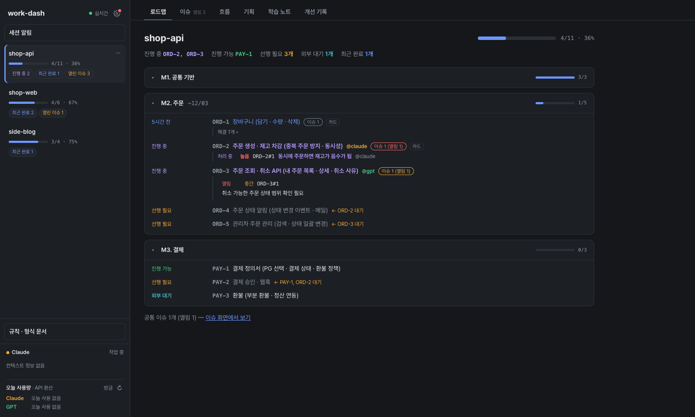
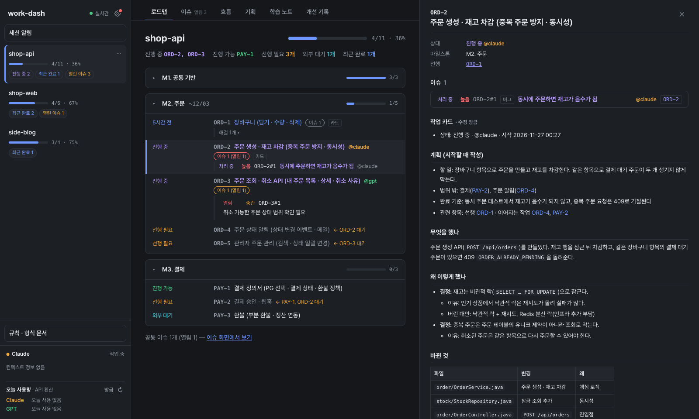
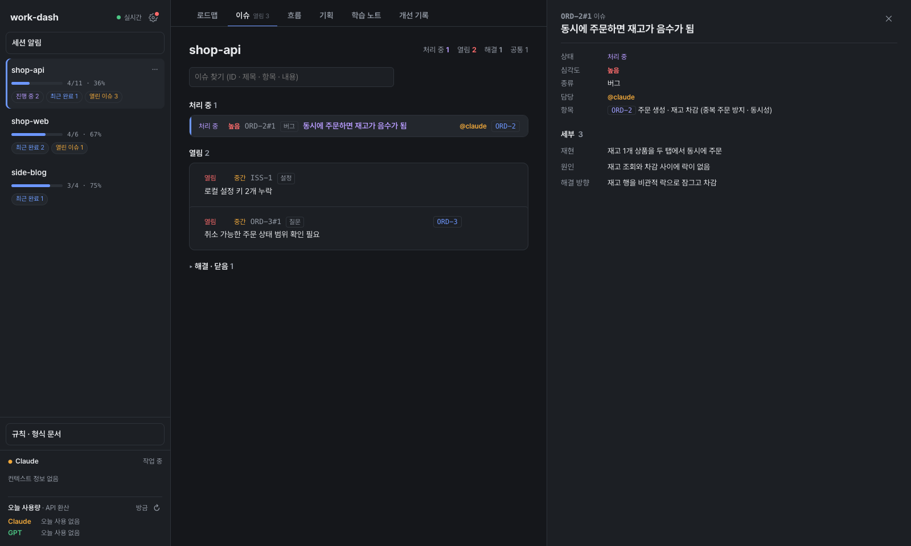
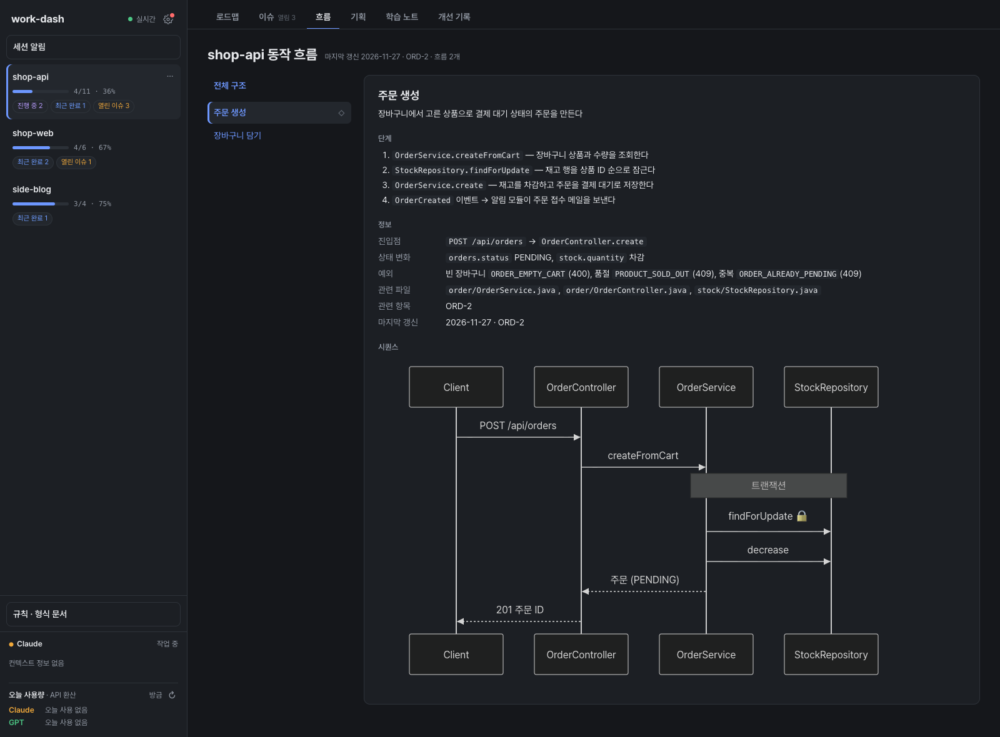
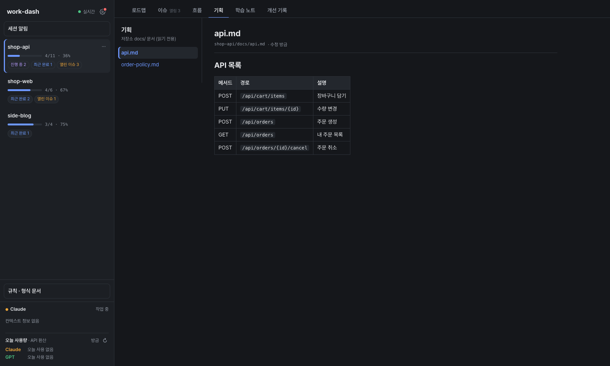
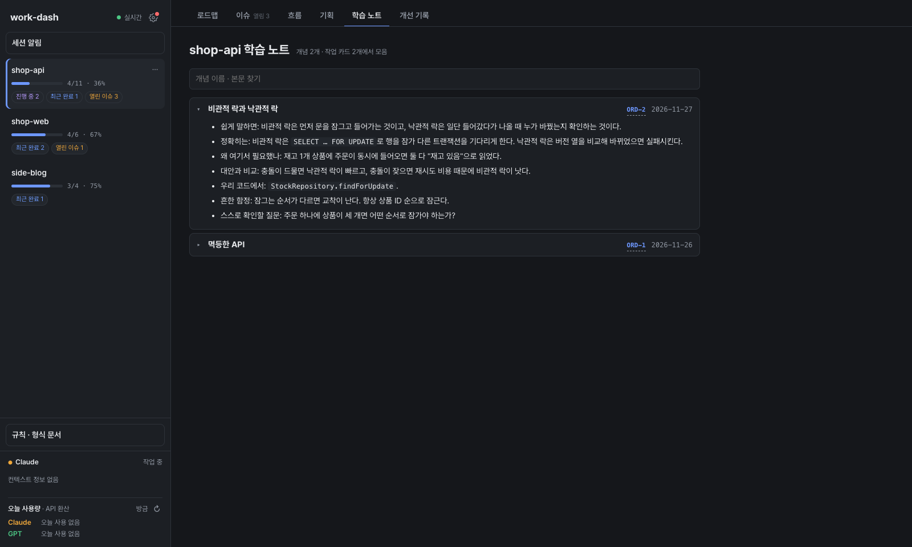
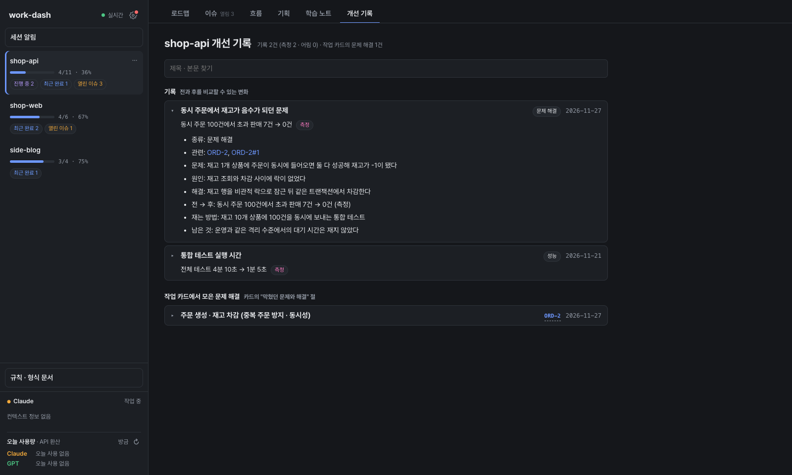
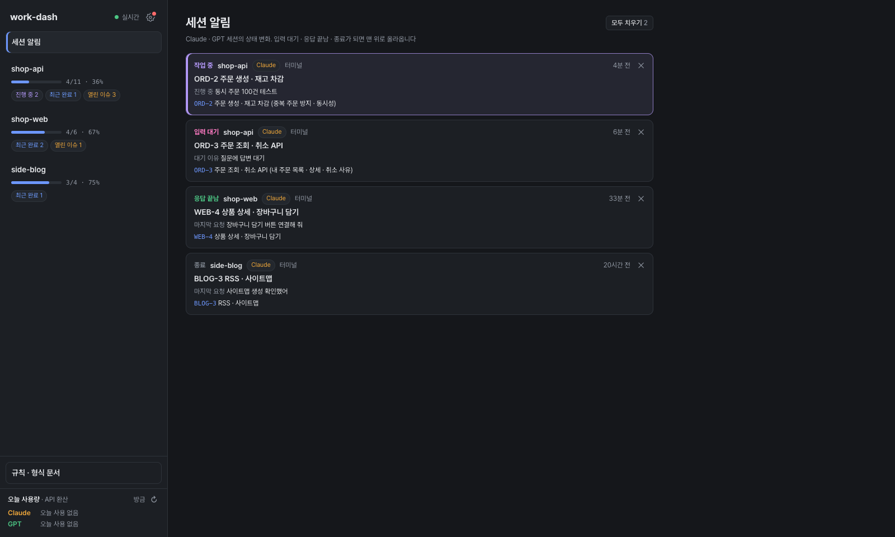
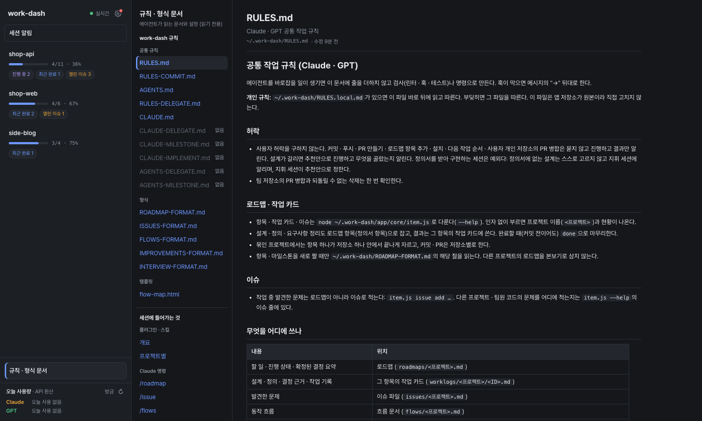
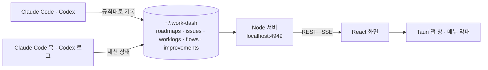

<div align="center">

# work-dash

**Claude Code · Codex 에이전트와 함께 일할 때, 로드맵 · 이슈 · 작업 카드 · 세션을 한눈에 보는 macOS 데스크톱 앱**

여러 에이전트 세션을 동시에 돌려도 무엇이 진행 중이고, 누가 입력을 기다리고, 오늘 얼마를 썼는지 바로 보입니다.



</div>

> **이 저장소는 더 고치지 않습니다.** 2026년 11월 시점의 모습을 그대로 둔 것이고, 기록 도구(`kit/`)도 그 시점의 사본입니다.

> 스크린샷은 저장소에 든 예시 데이터(`shop-api` · `shop-web` · `side-blog`)로 찍었습니다. 설치하지 않고 같은 화면을 띄워 볼 수 있습니다 → [예시로 먼저 보기](#예시로-먼저-보기)

## 왜 만들었나

에이전트에게 일을 맡기면 계획과 기록이 대화 속에 흩어집니다. work-dash는 에이전트와 사람이 **같은 마크다운 파일**을 보도록 합니다.

- 에이전트는 규칙(`~/.work-dash/RULES.md`)에 따라 로드맵 · 이슈 · 작업 카드 · 흐름 문서 · 개선 기록을 직접 씁니다.
- 앱은 그 파일을 읽어 보여 주고, 파일이 바뀌면 바로 갱신합니다.
- Claude Code 훅과 Codex 로그로 세션 상태를 모아 알림 카드로 보여 줍니다.

## 주요 기능

| 기능 | 설명 |
|---|---|
| **로드맵** | 마일스톤별 진행률, 항목 상태(완료 · 진행 중 · 진행 가능 · 선행 필요), 담당(`@claude` · `@gpt`), 완료 시각, 마일스톤 접기 |
| **작업 카드** | 항목을 누르면 옆에 카드 패널. 계획 · 결정 이유 · 바뀐 파일 · 검증과 그 항목이 진행된 시간대의 커밋 · 요청 기록 |
| **이슈** | 처리 중 · 열림 · 해결로 묶인 이슈 목록, 검색, 이슈 카드(재현 · 원인 · 해결 방향) |
| **흐름 문서** | 프로젝트 동작 흐름을 Mermaid 다이어그램(구성 · 상태 · 시퀀스)과 함께 표시 |
| **기획** | 프로젝트 저장소 `docs/`의 문서를 읽기 전용으로 표시 |
| **학습 노트** | 작업 카드에 적힌 개념 설명을 프로젝트별로 모아 검색 |
| **개선 기록** | 전과 후를 비교할 수 있는 변화(측정 · 어림)와 작업 카드의 문제 해결 기록 |
| **세션 알림** | 세션당 카드 1장. 입력 대기 · 응답 끝남 · 종료로 바뀌면 맨 위로. 누르면 연결된 작업 카드를 띄우고 대화(Claude 앱 · ChatGPT 앱 · iTerm)를 엽니다. 입력 대기는 macOS 알림 |
| **오늘 사용량** | Claude · Codex 오늘 비용(API 단가 환산) · 토큰, 고른 프로젝트 세션의 컨텍스트 사용량 |
| **규칙 · 형식 문서** | 에이전트가 읽는 규칙 · 형식 문서 · 슬래시 명령 · 스킬 · 설정을 앱에서 바로 확인(비밀 값은 가림) |
| **설정** | 설치가 꼬인 곳을 단계별로 보여 주고 버튼으로 고침 |
| **편의** | 프로젝트 보관 · 휴지통, 패널 · 사이드바 폭 드래그(기억), 메뉴 막대 상주, 새 화면 빌드 시 창 자동 새로고침 |

## 둘러보기

### 작업 카드
항목을 누르면 오른쪽에 작업 카드가 열립니다. 카드의 ID를 누르면 그 프로젝트 로드맵의 해당 항목으로 이동합니다.



### 이슈
이슈 줄을 누르면 이슈 카드가 열리고, 부모 항목을 누르면 그 작업 카드로 바뀝니다.



### 흐름 문서
`~/.work-dash/flows/<프로젝트>.md`의 구성도 · 상태 다이어그램 · 시퀀스를 그립니다.



### 기획
프로젝트 저장소의 `docs/` 문서를 그대로 읽습니다. 앱에서는 고치지 않습니다.



### 학습 노트
작업 카드에 남긴 개념 설명을 한곳에 모읍니다. 항목 ID를 누르면 그 설명이 나온 작업 카드로 갑니다.



### 개선 기록
무엇이 얼마나 나아졌는지를 전 → 후 숫자와 재는 방법까지 남깁니다.



### 세션 알림
여러 에이전트 세션의 상태 변화가 알림처럼 쌓입니다. 카드를 누르면 옆에 작업 카드가 뜨고 그 대화가 열립니다.



### 규칙 · 형식 문서
에이전트에게 준 규칙을 앱 안에서 그대로 읽습니다.



## 구조



| 폴더 | 역할 |
|---|---|
| `kit/` | 기록 도구 사본. 규칙 · 형식 문서(`rules/`), 파서 · 명령 · 훅(`core/`), 화면용 읽기 함수(`view/`), 설치기(`bin/install.js`) |
| `server/` | Node 내장 `http` 서버. `kit/`의 파서를 불러 API · SSE(파일 변경 알림)를 제공하고 빌드된 화면을 서빙 |
| `src/` | React + TypeScript 화면 (Vite) |
| `desktop/` | Tauri 2 앱. 서버를 띄우거나 이미 떠 있는 서버를 쓰고, 창 · 메뉴 막대 아이콘을 담당 |
| `demo/` | 예시 데이터와 그것으로 대시보드를 띄우는 실행기 (`npm run demo`) |
| `bin/work-dash-app.js` | 서버 관리 명령 (`status · stop · restart · logs`) |

## 개발 기록

전부터 쓰던 마크다운 기록과 파서 위에, 화면과 데스크톱 앱을 Claude Code · Codex 에이전트와 함께 19일 동안 만들었습니다. 계획과 결정은 이 앱이 보여 주는 바로 그 형식(로드맵 · 작업 카드)으로 남겼고, 아래는 그것을 간추린 것입니다.

| | |
|---|---|
| 기간 | 2026-11-09 ~ 2026-11-27 (19일) |
| 커밋 · PR | 약 160개 · 44개 |
| 로드맵 | 마일스톤 16개, 항목 115개 중 104개 완료 |
| 구성 | React + TypeScript 화면, Node 서버, Tauri 2(Rust) 앱, 기록 도구(파서 · 훅 · 린터) |

숫자는 공개 전 개발 저장소 기준입니다. 이 저장소는 공개용으로 새로 올려서 커밋 기록이 짧습니다.

**무엇을 어떤 순서로 만들었나** → [개발 로드맵](docs/roadmap.md)

| 단계 | 만든 것 |
|---|---|
| 화면 | 로컬 서버와 로드맵 · 이슈 · 작업 카드 · 흐름 문서 화면, 파일이 바뀌면 바로 갱신 |
| 데스크톱 앱 | Tauri 창과 메뉴 막대 상주, 설치 명령 |
| 세션 알림 | 여러 에이전트 세션의 상태 카드, 대화 열기, 오늘 사용량 |
| 검사로 지키는 규칙 | 문서 린터, 커밋 · PR 앞 검사 훅, 바뀐 파일에 맞는 확인만 고르는 명령 |
| 설치와 공개 | `init` · `uninstall`, 환경 점검, 기록 도구 떼어 내기 |

**왜 그렇게 만들었나** → [주요 결정과 문제 해결](docs/decisions.md)

- **Rust로 다시 쓰기 전에 먼저 쟀습니다.** "웹뷰가 훨씬 클 것"이라는 예상과 달리 Node 서버가 앱 메모리의 39 ~ 51%였습니다. 살아 있는 데이터는 약 10MB뿐이어서, 요청마다 파일을 다시 읽는 구조부터 의심했습니다.
- **규칙을 글에서 검사로 옮겼습니다.** 에이전트에게 준 규칙 문서를 늘리는 대신 린터 · 훅 · 명령으로 만들고, 오류 메시지에 고치는 법을 적었습니다.
- **막는 훅에는 대신 쓸 길을 함께 줬습니다.** 큰 문서를 통째로 읽는 호출을 막으면서 항목 하나만 보여 주는 명령을 같이 만들었습니다.
- **기록 도구를 앱에서 떼어 냈습니다.** 다른 에이전트 앱의 플러그인으로 같은 보기를 만들고 나니 이 앱은 여러 화면 가운데 하나가 됐습니다. 그래서 기록하는 쪽을 떼어 냈고, 이 앱은 여기서 멈췄습니다.

## 예시로 먼저 보기

내 설정을 건드리지 않고 화면부터 볼 수 있습니다.

```bash
git clone https://github.com/XeXyeon/work-dash-app.git
cd work-dash-app
npm install
npm run build
npm run demo           # http://localhost:4950 (Ctrl-C로 끝냄)
```

임시 폴더를 홈으로 삼아 그 안에서만 설치하고 서버를 띄웁니다. `~/.work-dash` · `~/.claude` · `~/.codex`는 읽지도 쓰지도 않고, 끝내면 임시 폴더를 지웁니다. 포트는 `npm run demo -- --port 5000`으로 바꿉니다.

## 시작하기

### 준비물
- macOS
- Node.js 20 이상
- Claude Code (필수), Codex (있으면 함께 설정)
- Rust · Tauri 2 빌드 환경 (데스크톱 앱으로 설치할 때만)

### 설치

화면만 볼 것이면 받아서 빌드하면 됩니다. 서버는 저장소에 든 `kit/`을 읽습니다.

```bash
git clone https://github.com/XeXyeon/work-dash-app.git
cd work-dash-app
npm install
npm run build
```

에이전트가 기록을 남기게 하려면 기록 도구를 설치합니다. 바꿀 내용을 먼저 보여 주고, 확인하면 적용합니다.

```bash
node kit/bin/install.js init        # ~/.work-dash 에 기록 폴더 · 규칙 문서를, Claude Code · Codex 에 훅 · 명령을 넣음
node kit/bin/install.js uninstall   # 넣은 것만 되돌림
```

고치는 파일은 먼저 `~/.work-dash/backup-init-<시각>/`에 백업합니다. 설치하면 `~/.work-dash/app`이 이 저장소의 `kit/`을 가리키므로 저장소 폴더를 옮기거나 지우면 훅이 멈춥니다.

### 실행

```bash
npm run build                  # 화면 빌드 (dist/)
node bin/work-dash-app.js      # 서버를 백그라운드로 띄움 → http://localhost:4949
```

데스크톱 앱으로 쓰려면:

```bash
npm run app:install    # Tauri 앱을 빌드해 /Applications/work-dash.app 에 설치하고 실행
```

앱을 켜면 서버(4949)가 없을 때 직접 띄우고, 이미 떠 있으면 그 서버를 씁니다.

### 개발

```bash
npm run dev            # Vite(5173) + 서버(4949, 코드가 바뀌면 재시작)
npm run app:dev        # Tauri 개발 모드
npm run typecheck
```

### 서버 관리 (선택)

```bash
node bin/work-dash-app.js status    # 실행 중인지, 화면 빌드가 최신인지
node bin/work-dash-app.js restart   # 서버 코드(server/)나 기록 도구를 바꿨을 때
node bin/work-dash-app.js logs
```

`~/.local/bin`이 `PATH`에 있으면 `work-dash status`처럼 짧게 쓸 수 있습니다.

### 에이전트가 쓰는 명령

에이전트는 파일을 직접 고치지 않고 아래 명령으로 기록합니다. 사람이 불러도 됩니다. 기록 도구를 설치한 뒤에 쓸 수 있습니다.

```bash
node ~/.work-dash/app/core/item.js           # 프로젝트 현황. 항목 · 작업 카드 · 이슈를 다룸 (--help)
node ~/.work-dash/app/core/check.js          # 바뀐 파일에 맞는 확인만 골라 돌림 (--full: 전체)
node ~/.work-dash/app/core/cdx.js <항목 ID>  # 항목 하나를 Codex에 넘김
```

### 환경 변수

| 이름 | 기본값 | 설명 |
|---|---|---|
| `WORK_DASH_APP_PORT` | `4949` | 서버 포트 |
| `WORK_DASH_DIR` | `~/.work-dash` | 데이터 폴더 |
| `WORK_DASH_KIT` | 저장소의 `kit/` | 서버가 읽을 기록 도구의 자리 |
| `WORK_DASH_APP_ROOT` | 빌드한 저장소 경로 | 앱이 서버를 띄울 때 쓸 저장소 위치 |
| `WORK_DASH_NOTIFY` | 켜짐 | `0`이면 입력 대기 macOS 알림을 끔 |
| `CODEX_HOME` | `~/.codex` | Codex 설정 · 로그 위치 |
| `VITE_PORT` | `5173` | 개발 화면 포트 |

## 데이터 형식

앱은 아래 파일만 읽습니다(보관 · 휴지통 같은 일부 조작만 씁니다). 형식은 `kit/rules/`의 형식 문서를 따릅니다.

| 파일 | 내용 | 형식 문서 |
|---|---|---|
| `roadmaps/<프로젝트>.md` | 마일스톤 · 항목 · 담당 · 선행 관계 | `ROADMAP-FORMAT.md` |
| `issues/<프로젝트>.md` | 작업 중 발견한 문제 | `ISSUES-FORMAT.md` |
| `worklogs/<프로젝트>/<ID>.md` | 항목별 작업 카드 | `ROADMAP-FORMAT.md` "작업 카드" |
| `flows/<프로젝트>.md` | 동작 흐름 · Mermaid 다이어그램 | `FLOWS-FORMAT.md` |
| `improvements/<프로젝트>.md` | 전과 후를 비교할 수 있는 개선 기록 | `IMPROVEMENTS-FORMAT.md` |
| 프로젝트 저장소 `docs/*.md` | 기획 탭에 보이는 문서 (읽기 전용) | - |
| `data/sessions/*.json` | Claude Code 훅이 남기는 세션 상태 | - |

## 알아 둘 점

- 개인용 도구입니다. 서버는 `127.0.0.1`에서만 열리고, 쓰기 · 실행 API는 다른 웹사이트(출처)에서 온 요청을 거절합니다.
- 오늘 사용량은 [ccusage](https://github.com/ryoppippi/ccusage)(버전 고정)로 1시간마다 계산하며, 금액은 실제 청구액이 아니라 API 단가 환산입니다. ↻ 버튼으로 바로 다시 계산할 수 있습니다.
- 대화 열기는 Claude 데스크톱 앱 링크, ChatGPT 앱의 `codex://` 링크, iTerm을 사용합니다. Claude 앱 내부 파일 형식이 바뀌면 데스크톱 세션 연결이 동작하지 않을 수 있습니다.

## 라이선스

[MIT](LICENSE)
