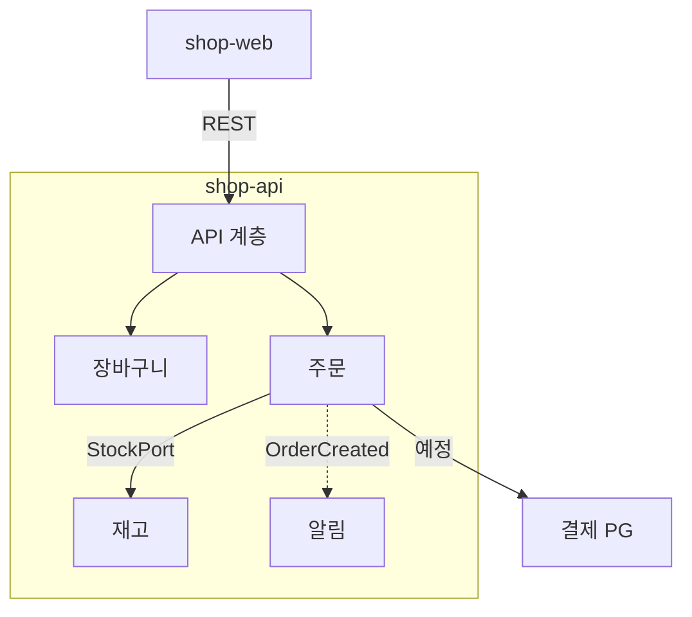
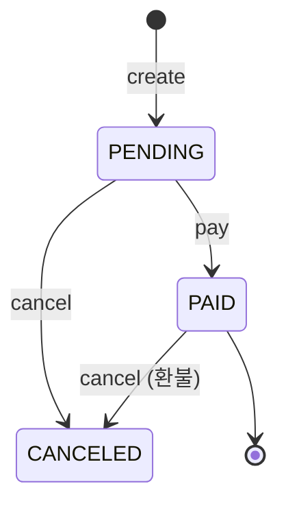
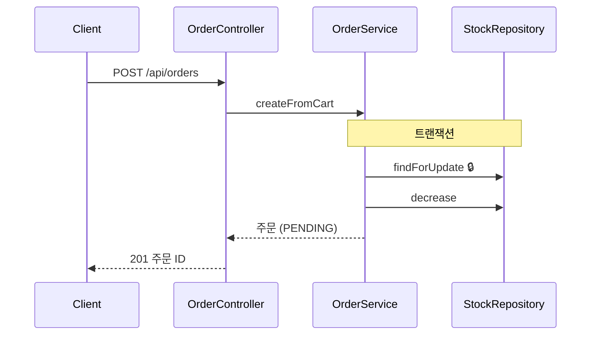

# shop-api 동작 흐름
> 마지막 갱신: {{d:-0d}} · ORD-2

## 전체 구조
### 경계 지도

### 상태 다이어그램

## 주문 생성
- 요약: 장바구니에서 고른 상품으로 결제 대기 상태의 주문을 만든다
- 진입점: `POST /api/orders` → `OrderController.create`
- 단계:
  1. `OrderService.createFromCart` — 장바구니 상품과 수량을 조회한다
  2. `StockRepository.findForUpdate` — 재고 행을 상품 ID 순으로 잠근다
  3. `OrderService.create` — 재고를 차감하고 주문을 결제 대기로 저장한다
  4. `OrderCreated` 이벤트 → 알림 모듈이 주문 접수 메일을 보낸다
- 데이터·상태 변화: `orders.status` PENDING, `stock.quantity` 차감
- 예외: 빈 장바구니 `ORDER_EMPTY_CART`(400), 품절 `PRODUCT_SOLD_OUT`(409), 중복 `ORDER_ALREADY_PENDING`(409)
- 관련 파일: `order/OrderService.java`, `order/OrderController.java`, `stock/StockRepository.java`
- 관련 항목: ORD-2
- 마지막 갱신: {{d:-0d}} · ORD-2

## 장바구니 담기
- 요약: 로그인한 사용자의 장바구니에 상품을 담는다. 이미 있으면 수량을 더한다
- 진입점: `POST /api/cart/items` → `CartController.add`
- 단계:
  1. `CartService.add` — 같은 상품이 있으면 수량을 더하고, 없으면 항목을 만든다
- 예외: 없는 상품 `PRODUCT_NOT_FOUND`(404)
- 관련 파일: `cart/CartService.java`, `cart/CartController.java`
- 관련 항목: ORD-1
- 마지막 갱신: {{d:-1d}} · ORD-1
