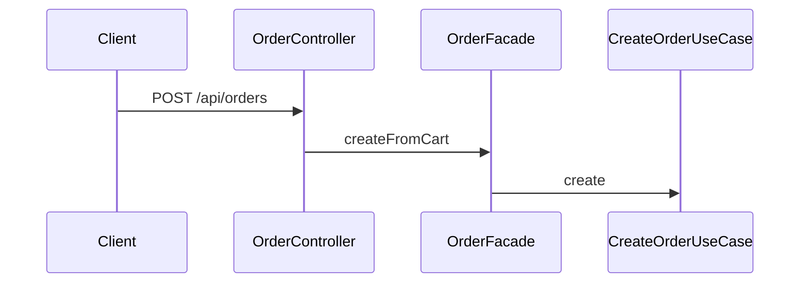

# 동작 흐름 문서 (Claude · GPT 공통)

Claude의 `/flows` 커맨드와 Codex의 `flows` 스킬이 모두 이 파일을 따른다.
프로젝트가 **지금 실제로 어떻게 동작하는지**를 흐름(기능) 단위로 모아 두는 살아 있는 문서다.
새 세션이나 다른 AI가 프로젝트를 파악할 때 코드를 훑는 대신 이 문서를 먼저 본다. 문서가 크므로 통째로 읽지 않는다. `## 전체 구조`는 항상 읽고, 흐름 절은 제목 목록(`^## `)을 본 뒤 고칠 파일 경로 · 클래스 이름 · 항목 ID로 검색해 걸리는 절을 모두 읽는다.

## 파일
- 원본: `~/.work-dash/flows/<프로젝트 이름>.md` (Markdown). 개인용이며 저장소에 커밋하지 않는다.
- 보기: work-dash 데스크톱 앱의 흐름 화면. 앱이 원본(.md)을 직접 읽어 그리며, 보기용 HTML은 따로 만들지 않는다.
- 팀 공유 페이지(선택): 데이터 `~/.work-dash/flows/<프로젝트>.share.json` → `node ~/.work-dash/app/core/tools/flow-share.js <프로젝트>` → 템플릿 `~/.work-dash/app/core/templates/flow-map.html`을 채운 한 장짜리 HTML. 아래 `share` 동작 참고.

## 형식
```markdown
# <프로젝트> 동작 흐름
> 마지막 갱신: 2026-10-20 · IORD-8

## 개인 주문 생성
- 요약: 장바구니에서 고른 상품으로 결제 대기 상태의 주문을 만든다
- 진입점: `POST /api/orders` → `OrderController.create`
- 단계:
  1. `OrderFacade.createFromCart` — 장바구니 상품과 수량을 조회한다
  2. `CreateOrderUseCase.create` — 주문과 주문 상품을 만들고 결제 대기로 저장한다
  3. 결제 완료 이벤트 → `CartOrderEventListener` — 주문한 수량만큼 장바구니에서 뺀다
- 데이터·상태 변화: `orders.status` PENDING → PAID / CANCELED
- 예외: 빈 장바구니 `ORDER_EMPTY_CART`(400), 품절 `PRODUCT_SOLD_OUT`(409)
- 관련 파일: `order/app/personal/OrderFacade.java`, `order/in/personal/OrderController.java`
- 관련 항목: IORD-6, IORD-8
- 마지막 갱신: 2026-10-20 · IORD-8


```

- 흐름 하나 = `##` 절 하나. 사용자 입장에서 하나의 기능 단위로 나눈다 (예: 주문 생성, 결제, 취소, 공동구매 참여).
- 항목은 위 순서를 따르고, 해당 없는 항목(예외가 없으면 "예외")은 줄째 뺀다.
- Mermaid 시퀀스 다이어그램은 **단계가 4개 이상이거나 여러 서비스·이벤트가 얽힐 때만** 넣는다. 10~20줄 안으로.
- 클래스·메서드 이름은 실제 코드와 정확히 같게 쓴다. 추측으로 채우지 않는다.

### 저장소가 여럿인 프로젝트 (프론트 · 백엔드 묶음)
`~/.work-dash/config.json`의 `projects`로 저장소 여러 개를 한 프로젝트로 묶었으면, 흐름 문서도 하나다.

- **기능 하나 = 절 하나.** 화면에서 시작해 API를 거쳐 화면으로 돌아오는 기능은 프론트와 백엔드를 **한 절에** 쓴다. 저장소별로 절을 나누지 않는다. 두 저장소가 주고받는 순서(리다이렉트, 토큰 교환, 401 후 재시도, 외부 저장소 직접 업로드 등)가 그 기능의 핵심이기 때문이다.
- **저장소 표시:** 단계 · 관련 파일에 `FE:` · `BE:`를 붙여 어느 저장소의 코드인지 적는다. 경로는 각 저장소 루트 기준. 예: `1. FE: \`LoginForm.onSubmit\` — …`, `- 관련 파일: FE: \`src/app/auth/login/page.tsx\` · BE: \`auth/api/AuthController.java\``.
- **시퀀스 참여자:** 브라우저 · 프론트 서버(프록시 · API 라우트)를 백엔드 컴포넌트와 같은 그림에 둔다. 참여자 이름 앞에 저장소를 붙이지 않고, 저장소가 헷갈리면 `participant FE_Proxy as Next 프록시`처럼 별칭을 쓴다.
- **한쪽 저장소에만 있는 흐름**(백엔드 배치 · 관리자 API, 프론트 전용 화면 상태 등)은 그 저장소 단계만 쓴다.
- **여러 화면이 함께 쓰는 프론트 구조**(라우팅 · 접근 제어 · API 클라이언트와 타입 생성 · 토큰 보관 · 캐시)는 흐름마다 반복하지 않고 `## 전체 구조`의 `### 프론트 구조` 소제목에 한 번만 쓴다.
- **아직 한쪽이 따라오지 않은 흐름**(백엔드는 새 API, 프론트는 옛 API 등)은 그리지 않고 `- 진행 중 차이:` 한 줄로 적는다. 양쪽이 맞춰진 뒤 그 절에 단계를 채운다.

### 문서 머리말 (선택)
- 제목과 `> 마지막 갱신` 다음, 첫 `##` 앞에 짧은 머리말을 둘 수 있다: 코드 기준, 그림 표기, 경로 접두사. 앱은 머리말을 "전체 구조" 화면 맨 위에 보여 준다.
- **코드 기준은 구조 전환 중일 때만 쓴다.** 지금 · 진행 중 · 목표를 표로 적는다(브랜치 · 커밋 · 근거 문서). 그림은 "지금"과 "목표" 두 장으로 그리고, "진행 중"은 차이 표나 흐름 절의 `- 진행 중 차이:` 줄로 적는다. 진행 중 브랜치는 계속 바뀌어서 그림으로 굳히면 가장 빨리 낡는다. 전환 중이 아니면 기준 표 없이 지금 코드만 그린다.

### `## 전체 구조` 절 (선택)
모듈이 3개 이상이거나 모듈 사이를 이벤트로 잇는 프로젝트는 첫 흐름 앞에 `## 전체 구조` 절을 둔다. 이 절은 흐름이 아니고 앱의 흐름 화면에서 별도 화면이 된다. `###` 소제목으로 필요한 것만 넣는다.

| 소제목 | 내용 | 형태 |
|---|---|---|
| 경계 지도 | 모듈 = 상자, 스키마 · 배포 경계 = `subgraph`. 동기 호출은 실선 + 포트(인터페이스) 이름, 이벤트는 점선 + 토픽 · 이벤트 이름과 전달 방식. 다른 사람 모듈은 내 모듈과 닿는 선만 | Mermaid `flowchart` |
| 상태 다이어그램 | 상태가 있는 엔티티마다 한 장. 전이 라벨 = 메서드 이름 + 조건, 스케줄러가 일으키는 전이는 ⏰ | `stateDiagram-v2` |
| 이벤트 카탈로그 | 이벤트 · 토픽 · 발행 모듈 · 발행 지점(파일:줄) · 소비자와 방식 · 페이로드 요지 · 멱등 키 (전환 중이면 + 목표 방식) | 표 |
| 프론트 구조 | 저장소가 묶인 프로젝트만. 라우팅 그룹 · 접근 제어 · API 클라이언트와 타입 생성 · 토큰 보관과 갱신 · 서버 상태 캐시 · 백엔드 연결 방식(프록시 · 직접 호출) | 짧은 글 · 표, 필요하면 `flowchart` |

- 소제목 아래에 짧은 글 · 표 · 목록을 자유롭게 둔다. 앱이 표와 목록을 그대로 보여 준다.

### 흐름 절 안의 그림이 여러 장일 때
- `#### 지금` · `#### 목표`처럼 소제목을 두고 그 아래에 Mermaid 블록을 하나씩 둔다. 앱은 바로 위 소제목을 그림 제목으로 쓴다.
- 단계가 기준별로 다르면 `- 단계 (지금):`처럼 괄호로 기준을 붙인다. 다른 기준과의 차이는 `- 진행 중 차이:` 한 줄로 적는다.

### 그림 표기 (모든 프로젝트 공통)
- 시퀀스: `->>` = 동기 호출 또는 같은 트랜잭션 안 처리, `-->>` = 커밋 뒤 전달(AFTER_COMMIT · 아웃박스 릴레이 · 메시지 브로커), `Note over A,B:` = 트랜잭션 경계. 🔒 = 행 락, ⏰ = 스케줄러.
- Mermaid 문자열 안에 `;` · `#`을 쓰지 않는다(파서가 끊는다). 줄바꿈은 `<br/>`.
- 그린 뒤 한 번 렌더링해 깨지지 않는지 본다(work-dash 앱의 흐름 화면에서 열거나 Mermaid `parse`).
- 근거: 그림을 새로 그리거나 크게 바꾼 작업은 그 작업 카드에 `## 그림별 근거` 절을 두고 그림마다 파일:줄을 적는다. 목표(설계) 그림은 로드맵 항목 · 정의서 절을 근거로 적고, 근거가 없는 선은 문서에 그렇다고 적는다.

## 갱신 규칙 (깨작깨작)
- 로드맵 항목이 어떤 흐름을 **새로 만들거나 바꾸면**, 그 흐름의 `##` 절만 고친다. 파일 전체를 다시 쓰지 않는다.
- 고친 절의 "마지막 갱신"과 파일 맨 위 `> 마지막 갱신`을 `<날짜> · <항목 ID>`로 바꾼다.
- 흐름이 없어졌으면 절을 지우고, 새 기능이면 절을 추가한다.
- 고치기 직전에 **고칠 절만** 다시 읽는다 (다른 에이전트가 동시에 고쳤을 수 있다). 파일 전체를 다시 읽지 않는다.
- 갱신할 때 코드는 그 흐름의 "관련 파일"에 적힌 것만 본다. 흐름과 무관한 파일을 훑지 않는다.
- 갱신할 절을 빠뜨리지 않게, 항목을 끝낼 때 **이번에 바꾼 파일 경로와 클래스 이름으로 문서를 검색한다.** 걸리는 절이 모두 갱신 후보다(한 파일이 여러 흐름에 쓰일 수 있다). 후보 절마다 고쳤는지, 고칠 것이 없었는지를 작업 카드의 "주의 · 남은 일"에 적는다.

## 동작 (커맨드/스킬 인자)
- **인자 없음:** 절 제목(`^## `)과 `마지막 갱신` 줄만 검색해 흐름 목록과 마지막 갱신을 짧게 보고한다. 파일 본문은 읽지 않는다. 파일이 없으면 `init`을 안내한다.
- **init:** 파일이 이미 있으면 덮어쓰지 말고 알린다. 없으면 컨트롤러·이벤트 리스너·스케줄러 같은 진입점부터 코드를 훑어 주요 흐름의 초안을 만든다. 모듈이 3개 이상이면 `## 전체 구조` 초안도 만든다. 범위가 크면 서로 독립인 갈래(상태 머신 · 이벤트 발행/구독 · 모듈 간 호출 · 시나리오)로 나눠 서브에이전트에 맡긴다. 초안의 흐름 목록을 사용자에게 보여 주고 확인받은 뒤 파일을 만든다.
- **update <흐름 이름 또는 항목 ID>:** 해당 흐름 절만 코드와 대조해 고친다.
- **check [흐름 이름]:** 각 흐름의 관련 파일이 아직 있는지, 메서드 이름이 바뀌지 않았는지 확인하고 어긋난 절을 알려 준다 (고치기 전에 사용자에게 묻는다). 흐름 이름을 주면 그 절만 본다. 코드를 읽어서 대조하지 않는다: 문서에서 "관련 파일"과 단계의 `클래스.메서드` 이름만 뽑아, 파일은 존재 여부를, 이름은 그 파일 안 검색으로 확인한다. 어긋난 절이 나왔을 때만 그 절과 해당 코드를 읽는다.
- **share:** 팀과 볼 한 장짜리 페이지를 만든다. `## 전체 구조`의 경계 지도와 대표 시나리오 시퀀스를 데이터 파일 `~/.work-dash/flows/<프로젝트>.share.json`으로 옮기고(형식은 `~/.work-dash/app/core/tools/flow-share.js` 머리 주석), `node ~/.work-dash/app/core/tools/flow-share.js <프로젝트> [출력 경로]`로 HTML을 만든다. Claude는 아티팩트로 게시하고, Codex는 만든 HTML 경로를 알려 준다.
  - 팀이 보는 페이지라 개인 경로 · 개인 로드맵/이슈 ID · 브랜치 · 세션 이름 · 담당자 실명을 넣지 않는다. 앞의 셋은 스크립트가 검사해 걸리면 만들지 않는다.
  - 게시한 링크는 해당 로드맵 항목의 `연결:` 줄과 작업 카드에 남긴다. 흐름 문서가 바뀌어 페이지도 고쳐야 하면 데이터 파일만 고치고 같은 링크로 다시 게시한다. 템플릿은 직접 고치지 않는다.
